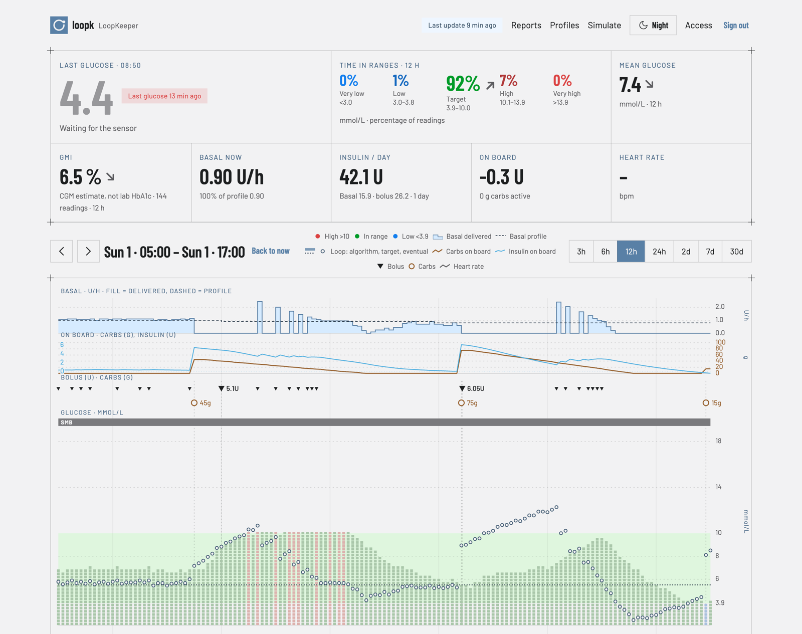
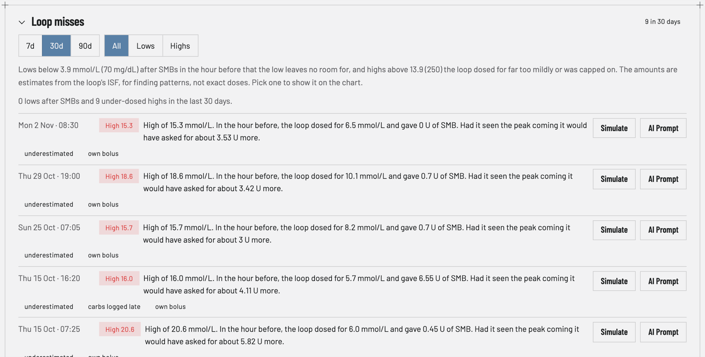
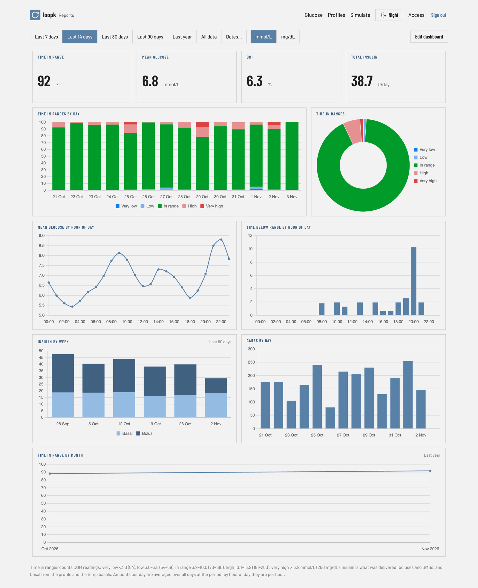
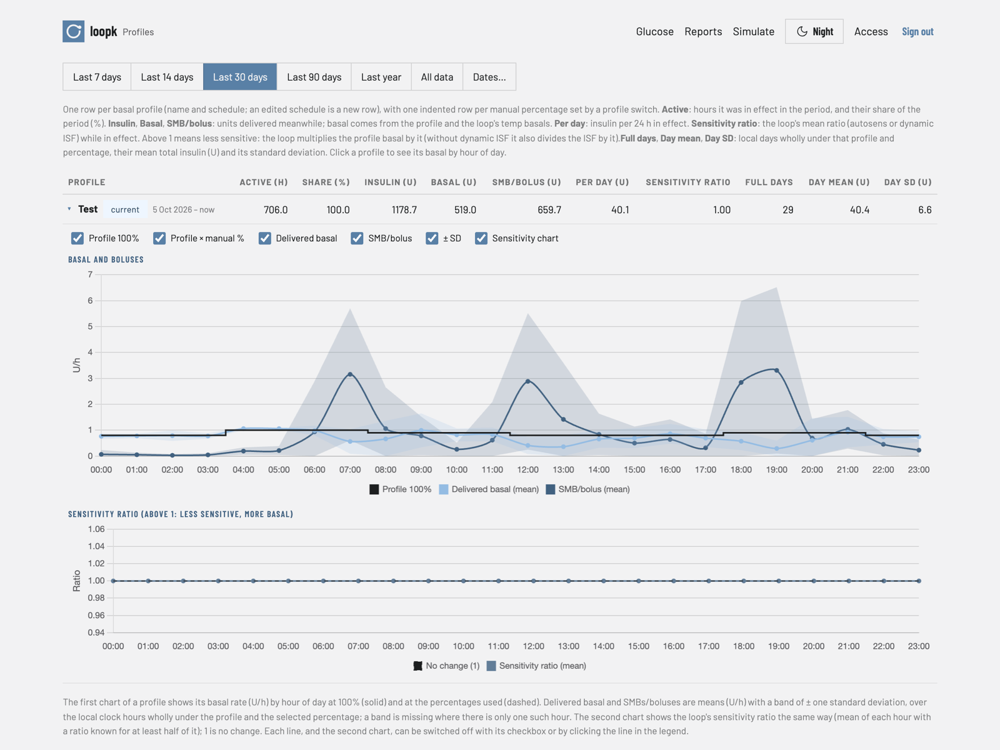
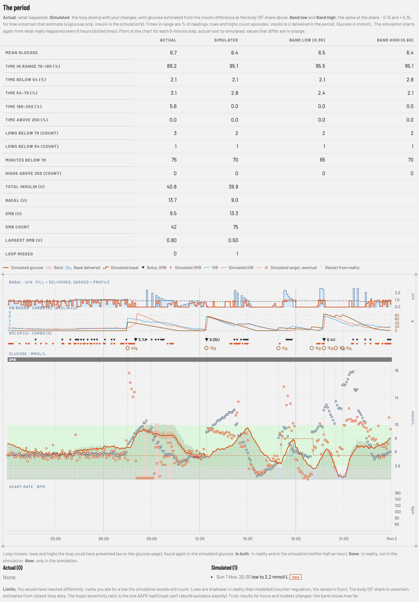

# Loopk

A Nightscout add-on for AAPS: better reporting, and simulation of changes to the loop's settings.

Open **https://loopk.cc**, enter your Nightscout address and an access token, and Loopk shows what your loop did, where it got it wrong, and what other settings would have done. Everything runs in your browser and reads straight from your Nightscout server: no Loopk server ever sees your data or your token.

## What you can do with it

### See what happened

The glucose page charts your CGM readings with boluses, carbs, temp basals and the basal profile, and pans back through your whole history. Turn on **Loop algorithm** to see each of AAPS's runs: which algorithm ran, its target and the glucose it expected, and, on hover, its prediction and decision. Tiles above the chart show time in ranges, mean glucose, GMI, the basal running now, insulin per day and what is on board.




### Find where the loop got it wrong

**Loop misses** lists the times the loop dosed badly, one sentence each, with the period to look at:

- **lows** it helped cause: SMBs in the hours before a low, more than the low left room for (for example SMBs for rescue carbs, or for the rebound after a low);
- **highs** it saw coming too late or too mildly: the glucose it expected stayed far below the peak, or a limit held its insulin back.

Exactly, a **low** is listed when:

1. glucose is below 70 mg/dL (3.9 mmol/L) for at least two readings; the low lasts until glucose is back at 80 mg/dL (4.4 mmol/L) or above;
2. the SMBs from 60 to 10 minutes before the low began add up to at least 0.5 U;
3. and they gave at least 0.5 U more than the low left room for. The room is the insulin that takes glucose from the loop's target down to the lowest reading: (target − lowest) / ISF, with the target and ISF of the run that gave the largest of those SMBs, and at most all of the SMBs.

A **high** is listed when:

1. glucose is above 180 mg/dL (10.0 mmol/L) until it is back at 170 mg/dL (9.4 mmol/L) or below, for at least 30 minutes, and peaks at 250 mg/dL (13.9 mmol/L) or above;
2. the loop ran in the hour before the high began;
3. and either the loop underestimated it, or a limit held it back:
   - **underestimated:** the glucose the loop dosed for stayed at least 90 mg/dL (5.0 mmol/L) below the peak. For each run in the hour before, that is the lower of its minPredBG and its eventual glucose, as oref sizes insulin on; the middle value (median) of the runs counts;
   - **held back:** a run from an hour before the high began until its peak hit a limit: an SMB cut to the SMB size limit ("Max minutes of basal to limit SMB to", or the one for UAM), insulin cut at max IOB, a temp basal cut to the max safe basal, or SMBs switched off. When the only limit was max IOB set to 0 because of duplicate glucose readings (AAPS's quality check: two readings at most 20 s apart among the newest 11), the high is marked as caused by them.

Readings more than 20 minutes apart split a low or a high; one that starts within 30 minutes of the end of the one before continues it.




### Report on any period

The reports page is a dashboard you arrange yourself. Each widget shows one metric (time in ranges, mean glucose, GMI, variability, insulin, carbs) as a number, chart or table, over the whole period or by day, week, month, year, hour of day or weekday. Compare this month with the last, or see which hours of the day go wrong.




### Understand your profiles

The profiles page shows the basal profiles in effect in a period, the time and insulin under each one and its manual percentages. Click one for a chart by hour of day, with what the loop and you changed on top of it, so you can see at which hours the loop keeps adding or holding back insulin.




### Try a change before you make it in AAPS

The simulator runs Loopk's ports of AAPS 3.4's algorithms (SMB, Dynamic ISF, AutoISF) on your own data:

- **One decision:** "With SMB basal minutes at 45 instead of 30, or ISF 10% stronger, what would the loop have done at 14:05?" Loopk decides that run again, exactly as AAPS would, and shows what changes.
- **A period:** "Had these settings been in place last week, how would glucose, lows, highs and insulin have looked?" Loopk doses the period again and estimates the glucose that would have followed, with a band for how sure it is.

Try a whole other profile as the **AI Test** profile and simulate with it; AAPS never sees it. When a change looks right, make it in AAPS yourself.




### Ask an AI agent

AI agents such as Claude Code, Codex or Gemini CLI can run Loopk's tools on their own computer, reading your Nightscout server directly. Ask them what you would ask an expert who has your data in front of them:

- "Why did I go low last night, and what would have prevented it?"
- "Is my ISF right in the mornings? Simulate last week with it 10% stronger."
- "Write me a profile with a higher basal from 4 to 7 am, and show what it would have changed."

The agent can read glucose, treatments, statistics, the profile, the loop's misses and each run's values, read how AAPS doses, simulate, and write an AI Test profile to simulate with. It cannot change anything in AAPS or Nightscout.

Add it with your Nightscout address and an access token there (Node 20 or later; Claude Code shown). Signed in on loopk.cc, the Access page shows the commands for Claude Code, Codex, Gemini CLI and Claude Desktop, filled in:

```sh
claude mcp add --scope user loopk \
  -e NIGHTSCOUT_URL=https://your.nightscout.example \
  -e NIGHTSCOUT_TOKEN=<an access token on it> \
  -- npx -y https://loopk.cc/mcp/local.tgz
```

It runs Loopk's current version at each start. To simulate with the loop settings you entered in the browser, export them on the Simulate page and save the file as `~/.config/loopk/settings.json` on that computer; an AI Test profile the agent writes goes into the same file, which the Simulate page can import.

The screenshots show made-up data (`scripts/nightscout-fake.js`), on the full server's pages, which the static pages share.

## What you need

- **AAPS uploading to Nightscout** (NSClient V3).
- **CORS on Nightscout**, so your browser may read it from loopk.cc: `ENABLE` must include `cors`.
- **An access token on Nightscout** with read access. Make one in Nightscout's admin tools.
- **A browser with passkeys** to keep the token on your device; without them, you enter the token again in each new tab.

## Your data stays yours

- **Code only from loopk.cc.** loopk.cc is a set of static files on GitHub Pages, built from this repository. It has no server that could receive your data.
- **Data only between your browser and your Nightscout.** Your browser reads Nightscout directly and keeps a copy on your device, so later visits load only what is new. Signing out deletes it.
- **The token in a passkey.** The token is encrypted with a secret only your passkey can produce (after Face ID, a fingerprint or the device PIN), and kept on your device. It is sent only to Nightscout.
- **Settings on your device.** The loop settings you enter for the simulator, the AI Test profile and your report dashboards stay in your browser. Export the loop settings and the AI Test profile as a file to move them to another browser or to an agent.

## Limits

- Loopk informs; it does not replace medical advice. The period simulation is an estimate: read its band and its notes.
- There are no glucose predictions of Loopk's own, and no heart rate (Nightscout has none).
- claude.ai and other web-only AI apps cannot use Loopk's tools: they need a server to connect to. Use an agent on your computer, or run the full server.

## Your own server

Loopk can also run as a server with its own Postgres database, which AAPS uploads to instead of Nightscout, with Google sign-in, an MCP endpoint for claude.ai and predictions: see [docs/full-server.md](docs/full-server.md). How the two differ is in [docs/modes.md](docs/modes.md), and how to work on Loopk in [docs/development.md](docs/development.md).

## Licence

loopk is licensed under the GNU Affero General Public License v3.0
(`LICENSE`). `src/oref/` ports AAPS's dosing algorithms and the
calculations behind their inputs from AndroidAPS
(https://github.com/nightscout/AndroidAPS, AGPL-3.0); each file names the
AAPS file and commit it follows. Under the AGPL, people who use loopk over a
network must be able to get its source.
